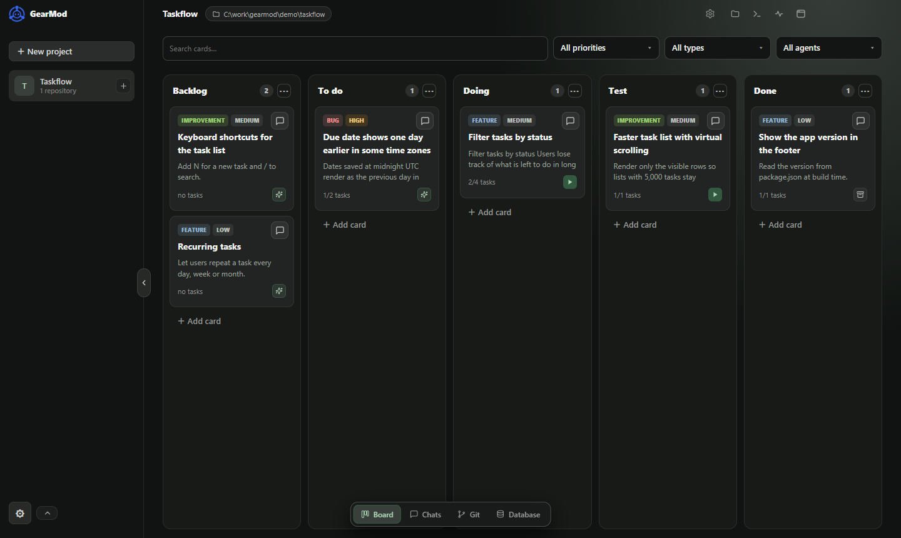
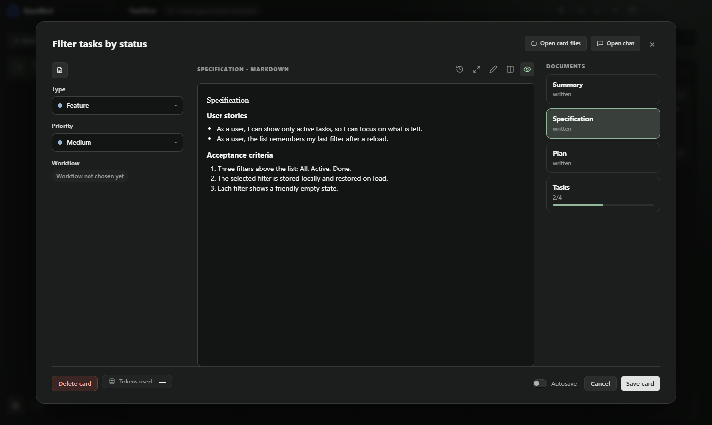

<div align="center">

# GearMod

**Multi-Agent Development Workspace**

*Shift gears. Build faster.*

[](https://github.com/flucassena/gearmod/releases/latest)

[](https://github.com/flucassena/gearmod/actions/workflows/ci.yml)
[](LICENSE.md)


**English** · [Português](README.pt-BR.md)

</div>

GearMod is a desktop app that turns your work into cards on a kanban board and hands each card to a coding agent, such as **Claude Code** or **Codex**. Every card runs in its own Git worktree, so agents work in parallel without touching your main checkout, and you review, commit and merge from the same window.

Everything runs on your machine. GearMod drives the agent CLIs you already use and has no server or account of its own.



## Features

**Plan before the agent writes code**
- Each card has a summary, a specification, a plan and a task list, written with the agent in a planning chat.
- Planning, implementation and testing are separate steps, each with its own chat, agent, model and permission mode.
- Spec-driven workflows, including [Spec Kit](https://github.com/github/spec-kit) projects, and a project Constitution that every agent follows.

**Run agents safely, side by side**
- One Git worktree and branch per card, named after the card type (`feature/…`, `fix/…`, `improvement/…`).
- Agents get a minimal environment instead of your full one, and risky actions ask first.
- Several agents can work at the same time; GearMod shows what each one is doing and how many tokens it used.

**Review and ship from one place**
- A built-in Git page with the commit graph, diffs, conflicts resolved block by block, rebase, stash and pull requests for GitHub and GitLab.
- An editor, a terminal and a file explorer next to the board, with the card's worktree as the working folder.
- A secret scan that blocks agent commits containing unmistakable keys or passwords.

**Tools for the agents**
- A local MCP server lets agents read and update their card, ask you questions and request commits.
- An optional code index gives agents symbol search and "which tests does this change affect".
- Skills, global or per project, picked with `/` in any chat.

**Optional extras**
- Voice dictation (local whisper.cpp or Groq), a PostgreSQL manager (experimental) and Playwright CLI for the tester agent.



## Install

**Requirements**
- Windows 10 or 11, 64-bit. Other platforms are not supported yet.
- [Git](https://git-scm.com/downloads).
- At least one agent CLI, installed and signed in: [Claude Code](https://docs.claude.com/en/docs/claude-code) or [Codex](https://github.com/openai/codex).

**Steps**
1. Open the [latest release](https://github.com/flucassena/gearmod/releases/latest) and download `GearMod-Setup-<version>-x64.exe`.
2. Run the installer. It installs for your user only and does not need administrator rights.
3. The installer is not code-signed yet, so Windows SmartScreen may show **"Windows protected your PC"**. Click **More info** and then **Run anyway**.
4. Open GearMod from the Start menu.

To check the download, compare its hash with `SHA256SUMS.txt` from the same release:

```powershell
Get-FileHash .\GearMod-Setup-<version>-x64.exe -Algorithm SHA256
```

To update, install the new version over the old one; your data is kept. To uninstall, use **Settings › Apps** in Windows. Uninstalling does not delete your data.

## Quick start

1. **Add a project.** Click **New project** and pick one or more Git repositories.
2. **Add an agent.** In **Settings › Agents**, register the Claude Code or Codex CLI you already use. GearMod detects installed CLIs and the account each one is signed in to.
3. **Create a card.** Describe what you want. The planning chat helps you write the specification, the plan and the tasks.
4. **Start the card.** GearMod creates the worktree and branch, and the agent implements the tasks. Answer its questions and approve risky actions as they come.
5. **Test and review.** Run the test step, read the diff on the Git page, then commit and open a pull request.

## How it works

```
Card ──► Git worktree + branch ──► Agent CLI (Claude Code / Codex)
  ▲                                            │
  └──────── MCP server (card, questions, commits) ◄┘
```

- **Worktrees:** each card gets its own folder and branch, so several agents can work at once without stepping on each other or on your main checkout.
- **Your agents, your accounts:** GearMod starts the CLIs you have installed, with your sign-in and your plan. It does not proxy or resell model access.
- **MCP bridge:** agents talk back to GearMod through a local MCP server to update the card, ask you questions and request commits.

## Your data

Everything lives on your machine, under `%APPDATA%\GearMod`: the SQLite database, attachments, backups and card worktrees. GearMod itself sends nothing anywhere. Optional features reach the network only when you turn them on; [SECURITY.md](SECURITY.md) lists them.

GearMod is **not a sandbox**: agents run with your user's permissions, within the permission mode you choose. Read [SECURITY.md](SECURITY.md) for what is and isn't promised.

## FAQ

**Is GearMod open source?**
GearMod is **source-available** under the [PolyForm Shield License 1.0.0](LICENSE.md). You can read, use, modify and redistribute the code, including inside a company, but you cannot use it to offer a product that competes with GearMod. It is not an OSI-approved open source license.

**Does it cost anything?**
GearMod is free to use. The agents use your own Claude or OpenAI plan.

**Does it work on macOS or Linux?**
Not yet. Windows is the only supported platform for now.

**Which agents are supported?**
Claude Code and Codex. Gemini CLI support exists but is disabled for now.

**Can I contribute?**
Outside pull requests are not accepted yet; bug reports and suggestions are welcome. See [CONTRIBUTING.md](CONTRIBUTING.md).

## Build from source

You need Node.js 22+, pnpm 11+ and Git on Windows.

```powershell
pnpm install      # also rebuilds better-sqlite3 for Electron
pnpm dev          # run the app in development mode
pnpm typecheck
pnpm lint
pnpm test
```

Build a runnable executable or the installer:

```powershell
powershell -ExecutionPolicy Bypass -File .\build.ps1       # apps/desktop/dist/win-unpacked/GearMod.exe
powershell -ExecutionPolicy Bypass -File .\installer.ps1   # apps/desktop/dist/GearMod-Setup-<version>-x64.exe
```

Both scripts close a running `GearMod.exe` from `win-unpacked`, because it locks the folder. The tests swap the native `better-sqlite3` binary between Node and Electron, so don't run them while the app is open from the same folder. Set `GEARMOD_DATA_DIR` to run against a throwaway data folder.

Releases are built by GitHub Actions: pushing a tag such as `v0.1.0` (matching the version in `apps/desktop/package.json`) builds the installer and publishes it with its checksum.

```
apps/desktop        Electron app (main process, preload, React renderer)
packages/contracts  Shared types and IPC contracts (Zod)
scripts             Maintenance scripts (third-party notices, Codex protocol types)
spike               Code index experiments (generates the tree-sitter queries)
```

## Contributing

GearMod does not accept outside pull requests yet: all changes are made by the maintainer. Bug reports and suggestions are welcome as [issues](https://github.com/flucassena/gearmod/issues), or by e-mail to sena.franciscolucas@gmail.com. See [CONTRIBUTING.md](CONTRIBUTING.md).

## License and trademarks

- Code: [PolyForm Shield License 1.0.0](LICENSE.md). See also [NOTICE](NOTICE).
- Third-party packages keep their own licenses; see [THIRD-PARTY-NOTICES.md](THIRD-PARTY-NOTICES.md).
- The GearMod name and logo are not covered by the code license; see [TRADEMARKS.md](TRADEMARKS.md).
- Claude Code, Codex and other product names belong to their owners. GearMod is not affiliated with Anthropic or OpenAI.
