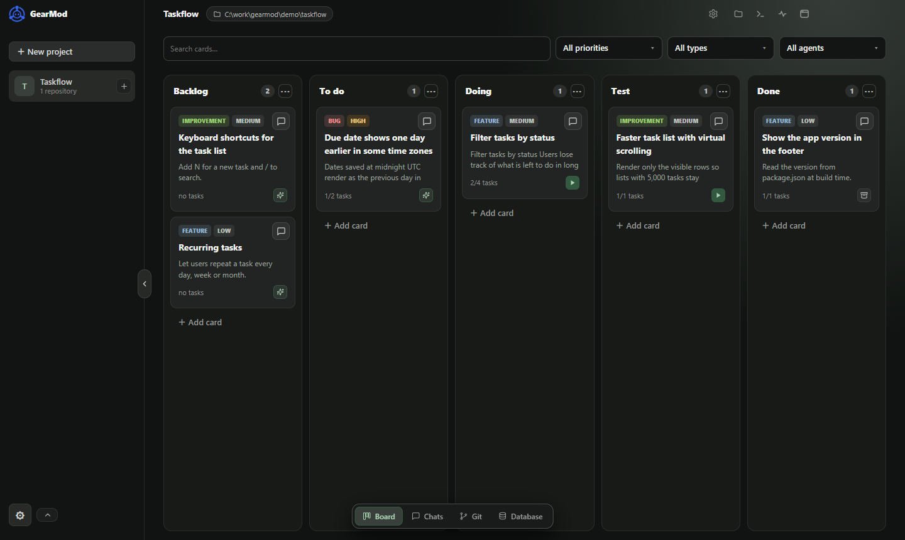
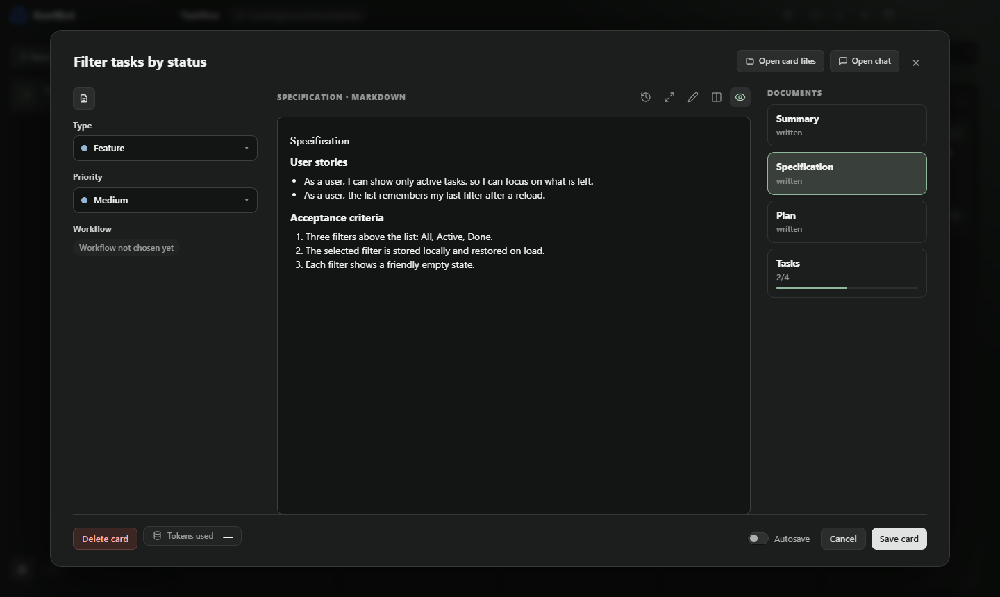

<div align="center">

# GearMod

**Espaço de desenvolvimento com vários agentes**

*Shift gears. Build faster.*

[](https://github.com/flucassena/gearmod/releases/latest)

[](https://github.com/flucassena/gearmod/actions/workflows/ci.yml)
[](LICENSE.md)


[English](README.md) · **Português**

</div>

O GearMod é um app desktop que transforma o seu trabalho em cards num quadro kanban e entrega cada card a um agente de programação, como o **Claude Code** ou o **Codex**. Cada card roda na sua própria worktree Git, então os agentes trabalham em paralelo sem mexer no seu checkout principal, e você revisa, commita e faz merge na mesma janela.

Tudo roda na sua máquina. O GearMod usa as CLIs de agente que você já tem e não tem servidor nem conta próprios.



## Recursos

**Planeje antes de o agente escrever código**
- Cada card tem resumo, especificação, plano e lista de tarefas, escritos com o agente num chat de planejamento.
- Planejamento, implementação e teste são etapas separadas, cada uma com seu chat, agente, modelo e modo de permissão.
- Fluxos guiados por especificação, inclusive projetos com [Spec Kit](https://github.com/github/spec-kit), e uma Constituição do projeto que todo agente segue.

**Agentes com segurança, lado a lado**
- Uma worktree e uma branch por card, com o nome do tipo do card (`feature/…`, `fix/…`, `improvement/…`).
- Os agentes recebem um ambiente mínimo em vez do seu ambiente completo, e ações arriscadas perguntam antes.
- Vários agentes trabalham ao mesmo tempo; o GearMod mostra o que cada um está fazendo e quantos tokens usou.

**Revise e entregue num só lugar**
- Uma página Git embutida, com o grafo de commits, diffs, conflitos resolvidos bloco a bloco, rebase, stash e pull requests para GitHub e GitLab.
- Editor, terminal e explorador de arquivos ao lado do quadro, com a worktree do card como pasta de trabalho.
- Uma verificação que bloqueia commits de agente com chaves ou senhas inconfundíveis.

**Ferramentas para os agentes**
- Um servidor MCP local deixa os agentes ler e atualizar o card, fazer perguntas e pedir commits.
- Um índice de código opcional oferece busca de símbolos e "quais testes esta mudança afeta".
- Skills globais ou por projeto, escolhidas com `/` em qualquer chat.

**Extras opcionais**
- Ditado por voz (whisper.cpp local ou Groq), gerenciador de PostgreSQL (experimental) e Playwright CLI para o agente de teste.



## Instalação

**Requisitos**
- Windows 10 ou 11, 64 bits. Outras plataformas ainda não são suportadas.
- [Git](https://git-scm.com/downloads).
- Pelo menos uma CLI de agente instalada e logada: [Claude Code](https://docs.claude.com/en/docs/claude-code) ou [Codex](https://github.com/openai/codex).

**Passos**
1. Abra a [última versão](https://github.com/flucassena/gearmod/releases/latest) e baixe o `GearMod-Setup-<versão>-x64.exe`.
2. Rode o instalador. Ele instala só para o seu usuário e não precisa de administrador.
3. O instalador ainda não é assinado, então o SmartScreen do Windows pode mostrar **"O Windows protegeu o computador"**. Clique em **Mais informações** e depois em **Executar assim mesmo**.
4. Abra o GearMod pelo menu Iniciar.

Para conferir o download, compare o hash com o `SHA256SUMS.txt` da mesma versão:

```powershell
Get-FileHash .\GearMod-Setup-<versão>-x64.exe -Algorithm SHA256
```

Para atualizar, instale a versão nova por cima da antiga; seus dados continuam. Para desinstalar, use **Configurações › Aplicativos** do Windows. Desinstalar não apaga seus dados.

## Primeiros passos

1. **Adicione um projeto.** Clique em **New project** e escolha um ou mais repositórios Git.
2. **Adicione um agente.** Em **Settings › Agents**, cadastre a CLI do Claude Code ou do Codex que você já usa. O GearMod detecta as CLIs instaladas e a conta em que cada uma está logada.
3. **Crie um card.** Descreva o que você quer. O chat de planejamento ajuda a escrever a especificação, o plano e as tarefas.
4. **Inicie o card.** O GearMod cria a worktree e a branch, e o agente implementa as tarefas. Responda às perguntas e aprove as ações arriscadas quando aparecerem.
5. **Teste e revise.** Rode a etapa de teste, leia o diff na página Git, depois commite e abra um pull request.

## Como funciona

```
Card ──► Worktree Git + branch ──► CLI do agente (Claude Code / Codex)
  ▲                                            │
  └──────── Servidor MCP (card, perguntas, commits) ◄┘
```

- **Worktrees:** cada card tem sua pasta e sua branch, então vários agentes trabalham ao mesmo tempo sem atrapalhar uns aos outros nem o seu checkout principal.
- **Seus agentes, suas contas:** o GearMod abre as CLIs que você instalou, com o seu login e o seu plano. Ele não intermedeia nem revende acesso a modelos.
- **Ponte MCP:** os agentes falam com o GearMod por um servidor MCP local para atualizar o card, fazer perguntas e pedir commits.

## Seus dados

Tudo fica na sua máquina, em `%APPDATA%\GearMod`: o banco SQLite, os anexos, os backups e as worktrees dos cards. O GearMod não envia nada para lugar nenhum. Recursos opcionais só usam a rede quando você os liga; o [SECURITY.md](SECURITY.md) lista quais são.

O GearMod **não é uma sandbox**: os agentes rodam com as permissões do seu usuário, dentro do modo de permissão escolhido. Leia o [SECURITY.md](SECURITY.md) para ver o que é e o que não é garantido.

## Perguntas frequentes

**O GearMod é open source?**
O GearMod é **source-available** (código disponível), sob a [PolyForm Shield License 1.0.0](LICENSE.md). Você pode ler, usar, modificar e redistribuir o código, inclusive dentro de uma empresa, mas não pode usá-lo para oferecer um produto que concorra com o GearMod. Não é uma licença open source aprovada pela OSI.

**Custa alguma coisa?**
O GearMod é gratuito. Os agentes usam o seu próprio plano do Claude ou da OpenAI.

**Funciona no macOS ou no Linux?**
Ainda não. Por enquanto, só no Windows.

**Quais agentes são suportados?**
Claude Code e Codex. O suporte ao Gemini CLI existe, mas está desativado por enquanto.

**Posso contribuir?**
Pull requests de fora ainda não são aceitos; relatos de bug e sugestões são bem-vindos. Veja o [CONTRIBUTING.md](CONTRIBUTING.md).

## Compilar a partir do código

Você precisa de Node.js 22+, pnpm 11+ e Git no Windows.

```powershell
pnpm install      # também recompila o better-sqlite3 para o Electron
pnpm dev          # roda o app em modo de desenvolvimento
pnpm typecheck
pnpm lint
pnpm test
```

Gerar um executável ou o instalador:

```powershell
powershell -ExecutionPolicy Bypass -File .\build.ps1       # apps/desktop/dist/win-unpacked/GearMod.exe
powershell -ExecutionPolicy Bypass -File .\installer.ps1   # apps/desktop/dist/GearMod-Setup-<versão>-x64.exe
```

Os dois scripts fecham o `GearMod.exe` aberto da pasta `win-unpacked`, porque ele trava a pasta. Os testes trocam o binário nativo do `better-sqlite3` entre Node e Electron, então não rode os testes com o app aberto da mesma pasta. Use `GEARMOD_DATA_DIR` para rodar com uma pasta de dados descartável.

As versões são geradas pelo GitHub Actions: enviar uma tag como `v0.1.0` (igual à versão de `apps/desktop/package.json`) gera o instalador e o publica com o checksum.

```
apps/desktop        App Electron (processo principal, preload, interface React)
packages/contracts  Tipos compartilhados e contratos de IPC (Zod)
scripts             Scripts de manutenção (avisos de terceiros, tipos do protocolo do Codex)
spike               Experimentos do índice de código (gera as consultas do tree-sitter)
```

## Contribuição

O GearMod ainda não aceita pull requests de fora: todas as mudanças são feitas pelo mantenedor. Relatos de bug e sugestões são bem-vindos como [issues](https://github.com/flucassena/gearmod/issues) ou por e-mail para sena.franciscolucas@gmail.com. Veja o [CONTRIBUTING.md](CONTRIBUTING.md).

## Licença e marcas

- Código: [PolyForm Shield License 1.0.0](LICENSE.md) (vale o texto em inglês). Veja também o [NOTICE](NOTICE).
- Os pacotes de terceiros mantêm suas licenças; veja o [THIRD-PARTY-NOTICES.md](THIRD-PARTY-NOTICES.md).
- O nome e o logo GearMod não estão cobertos pela licença do código; veja o [TRADEMARKS.md](TRADEMARKS.md).
- Claude Code, Codex e outros nomes de produtos pertencem aos seus donos. O GearMod não tem vínculo com a Anthropic nem com a OpenAI.
